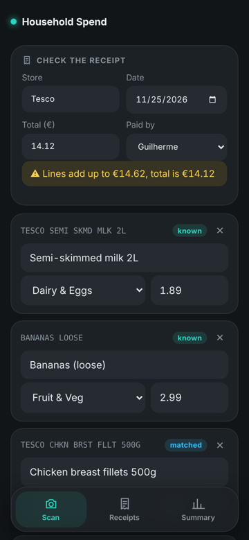
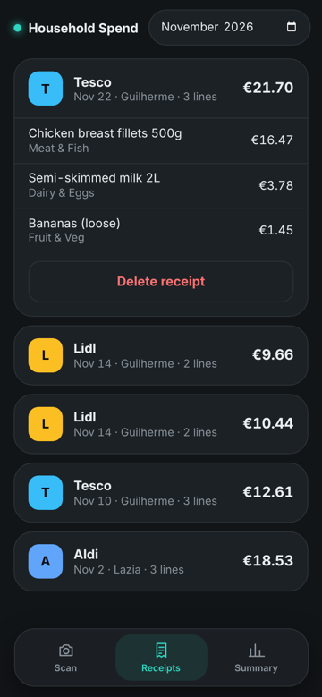
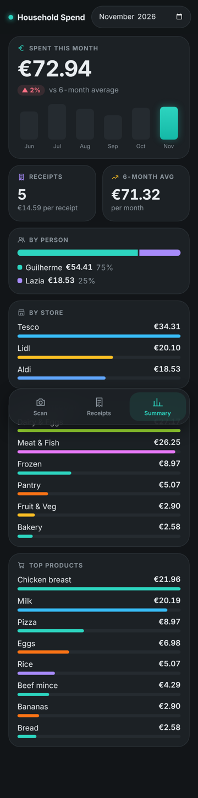
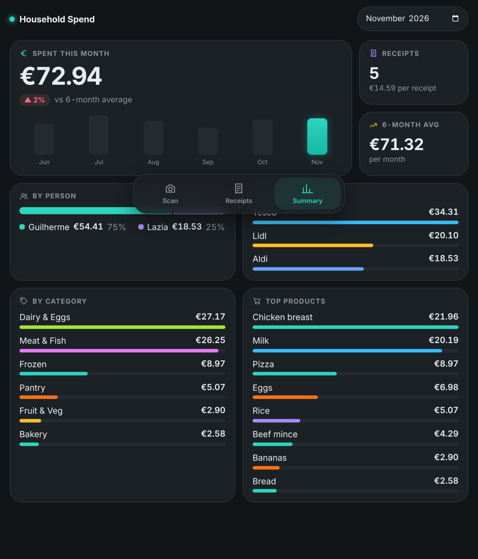

# Household Spend Tracker

Scan supermarket receipts with your phone, turn them into clean, structured
data, and see where the household's money goes.

Built for a two-person household in Dublin: both of us scan receipts from
Tesco, Lidl, Aldi, Dunnes and others, and the app merges everything into one
shared view of our spending. The same product is printed differently by every
store (`TESCO SEMI SKMD MLK 2L` vs `MILBONA S/SKIM MILK 2L`), so the core of
the project is a **product normalization pipeline** that maps those lines to a
single catalogue product.

| Review a scanned receipt | Receipts | Monthly summary |
|---|---|---|
|  |  |  |

The summary is a widget grid that switches to 4 columns in landscape, ready to be reused on a desk-hub screen:



## How it works

```
 phone photo ──► FastAPI ──► Gemini (vision) ──► structured receipt (JSON)
                                                        │
                       ┌────────── normalization ───────┘
                       ▼
   1. alias       same store printed this exact line before   → known product
   2. fuzzy alias near-identical line (OCR noise), same store → known product
   3. catalogue   model's suggested name ≈ existing product   → shared product
   4. new         nothing matches → user confirms the new product
                       │
                       ▼
          user reviews / corrects on the phone ──► PostgreSQL (Neon)
          corrections are saved as aliases, so the app learns
```

* **OCR + extraction:** Google Gemini reads the photo and returns items,
  quantities, discounts, store, date and total as JSON validated by Pydantic.
  The existing product catalogue is sent with the prompt so the model reuses
  canonical names.
* **Normalization:** `app/normalize.py` cleans receipt lines into stable keys
  and fuzzy-matches with RapidFuzz. Pack sizes must match exactly, so
  *milk 2L* never merges with *milk 1L*.
* **Learning from corrections:** every confirmed line is stored in
  `product_aliases` per store. The next time the same line appears it is
  matched instantly, without relying on the model.
* **Two levels of product:** `name` (Semi-skimmed milk 2L) and
  `generic_name` (Milk), plus a category, so spend can be analysed at any level.
* **Data checks:** the review screen warns when the lines don't add up to the
  total, and when the same store/date/total was already saved.

## Data model

| Table | Purpose |
|---|---|
| `stores` | Canonical store names |
| `products` | Canonical product catalogue (name, generic name, category) |
| `product_aliases` | How each store prints each product, the normalization memory |
| `receipts` | One row per receipt, with who paid |
| `receipt_items` | Receipt lines, linked to products; discounts as negative lines |
| `v_spending` | Flat view for analysis (Power BI, notebooks, the future dashboard) |

## Tech stack

Python 3.12 · FastAPI · PostgreSQL (Neon) · psycopg 3 · Pydantic ·
RapidFuzz · Google Gemini API · vanilla HTML/CSS/JS (mobile-first) · pytest

## Run locally

macOS / Linux:

```bash
python -m venv .venv
source .venv/bin/activate
pip install -r requirements-dev.txt
cp .env.example .env        # fill in DATABASE_URL, GEMINI_API_KEY, password, SECRET_KEY
uvicorn app.main:app --reload
```

Windows (PowerShell):

```powershell
python -m venv .venv
.venv\Scripts\Activate.ps1   # if blocked: Set-ExecutionPolicy -Scope CurrentUser RemoteSigned
pip install -r requirements-dev.txt
copy .env.example .env       # fill in DATABASE_URL, GEMINI_API_KEY, password, SECRET_KEY
uvicorn app.main:app --reload
```

Open http://localhost:8000. The tables are created automatically on startup.

To use it from a phone on the same Wi-Fi: `uvicorn app.main:app --host 0.0.0.0`
and open `http://<your-pc-ip>:8000`. The camera button needs HTTPS on iOS to
open the camera directly; over plain HTTP it falls back to the photo picker.

## Tests

The tests use a throwaway PostgreSQL database and a fake OCR reader, so they
don't call Gemini.

```bash
export TEST_DATABASE_URL=postgresql://postgres@localhost/receipts_test
pytest
```

## Deploy

`render.yaml` deploys the app on Render's free tier: connect the repo, then set
`DATABASE_URL`, `GEMINI_API_KEY` and `HOUSEHOLD_PASSWORD` in the dashboard.
The free tier sleeps after inactivity, so the first request can take a minute.

## Roadmap

- [x] Scan receipts, review, normalize products, monthly summary
- [ ] Attach discounts to the product they apply to
- [ ] Price history per product and store ("where is milk cheapest?")
- [ ] Manual expenses (rent, bills, transport) beyond groceries
- [ ] Budgets per category and savings goals
- [ ] Full analytics dashboard (trends, forecasts)
- [ ] Add to Home Screen as a PWA

## Privacy

Photos are sent to the Gemini API for reading and are not stored by this app.
On Google's free tier, Google may use submitted content to improve its
products, so avoid scanning anything sensitive.
